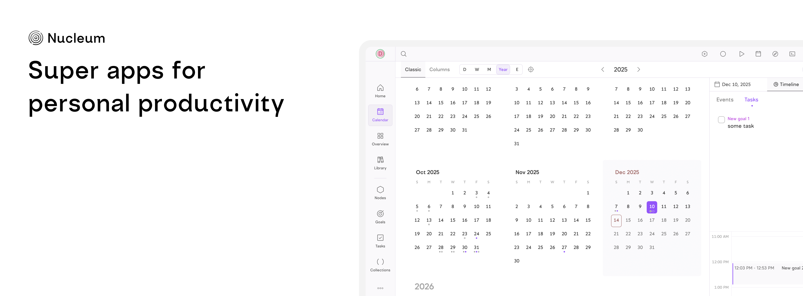

<div align="center">
  <h1>Nucleum</h1>
  <p>Meticulously crafted super apps to help you manage your digital life efficiently.</p>
</div>
<div align="center">

<br />

[](/LICENSE)
[](https://github.com/21nOrg/nucleus/actions/workflows/tests.yml)
[](https://discord.com/invite/9HJqKYTZKg)
[](https://www.youtube.com/@21nCo)

</div>

# Applications

| App      | Website                              | Description                                                                                                                                                 |
| -------- | ------------------------------------ | ----------------------------------------------------------------------------------------------------------------------------------------------------------- |
| Memotron | [memotron.app](https://memotron.app) | **Your memory atlas**, a tool for managing your digital memory and personal knowledge.<br><br>Tags: Digital memory, PKM, Note‑taking, Knowledge management. |
| Pointron | [pointron.app](https://pointron.app) | **Your focus haven**, a tool for tracking your goals and managing your time.<br><br>Tags: Focus, Time tracking, Goals, Events and Task management.          |

*For early access to our new products - please join our Discord [here](https://discord.com/invite/9HJqKYTZKg).

**Note:** All of the above tools are designed for personal use and lack team/group features like collaboration, sharing, etc.

# Self hosting

Currently, only the frontend apps can be self‑hosted on your own server. This means you cannot sync data between devices when self‑hosting. To deploy the offline‑only frontend at your own URL, follow these steps.

1. Clone/Fork this repository
2. This is a turbo repo with `/apps` folder containing apps that can be deployed. Choose the app sub-folder corresponding to the app you want to run.
3. Set the environment variables.
4. Deploy to the provider of your choice

```env
VITE_PRODUCT={{memotron | pointron | nucleum }}
VITE_STATIC_URL=https://cdn.21n.co
```

_Full app deployment including backend will be available soon..._

## Contributing

Due to the current size of our team, we are not accepting external contributions at this time. We appreciate your interest and understanding.

### License

This project is licensed under the AGPL-3.0 license. See the [LICENSE](LICENSE) file for details.

### Contact

For any questions, security reporting or feedback, please contact us at [hello@21n.co](mailto:hello@21n.co).

❤️ We extend our deepest gratitude to all the [OSS libraries and tools](https://github.com/21nOrg/nucleus/network/dependencies) that made this project possible.

## Code organization

Product bundles in `apps/` compose user-facing features from `client/features/`. `client/ui/` is the domain-free, portable `@21n/ui` package: `elements` owns atomic controls, `compositions` owns reusable compound UI such as charts, breadcrumbs, nested lists, search controls, and time controls, `actions` owns generic DOM behavior, `icons` owns portable icon assets and rendering, `illustrations` owns portable artwork, `branding` owns pure visual brand assets, and `environment` plus `hosts` provide package-wide integration contracts. Portable UI receives product behavior through props or narrow hosts and remains independent of application state, runtime infrastructure, products, features, DataFn, persistence, schema, and domain state. Product-independent Nucleum behavior shared across features or products lives in named subdirectories of `client/shared-state/` and is imported from `@nucleum/shared-state/*`, including command ports and application events; this package must not depend on application, feature, or product implementations. `schema/` owns cross-layer contracts, `client/datafn/` owns storage and sync, and `services/account/` owns the backend. Application composition lives in `client/composition/`; account, settings, sharing, library and other workflows live in `client/surfaces/`; navigation, notification presentation and shortcut execution live in `client/shell`; UI-independent infrastructure lives in `client/runtime/`. State is colocated with app context, runtime, preferences, persistence, shell, or feature owners rather than a generic `client/state` directory.

See [client boundaries](docs/architecture/client-boundaries.md) for the current ownership model, [type ownership](docs/architecture/type-ownership.md) for contracts, and [CONTRIBUTING.md](CONTRIBUTING.md) for maintainer orientation.
