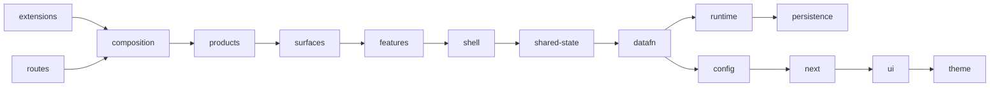

# Client ownership and import boundaries

Tracked in [TIDY-477](https://linear.app/21n/issue/TIDY-477/enforce-architectural-boundaries-after-client-feature-and-datafn).

## Delivery checklist

- [x] Commit the existing reorganization separately from schema, session, and popover fixes.
- [x] Move shared focus preferences and sound state into focus ownership, retaining persistence keys.
- [x] Remove the composition/session-store cycle by passing fixed end times explicitly.
- [x] Move memory upload, search-result, and synced-id helpers out of product implementations.
- [x] Supply the graph layout from the product shell.
- [x] Move authentication, network authority, connectivity, and logging into non-UI runtime ownership.
- [x] Move the active-resource UI store out of DataFn and avatar/icon catalogs into UI ownership and initial app data into configuration.
- [x] Remove unused mutation-label helpers from DataFn and depend on the observable-store interface instead of its implementation.
- [x] Move shared product contracts and navigation metadata out of product implementations.
- [x] Enforce completed boundaries and declare existing public feature entry points.
- [x] Pass compiler checks for Nucleum, Pointron, Memotron, and account-service.
- [x] Pass seven schema tests, two focus-preferences tests, and three popover tests.
- [x] Pass four Nucleum focus browser scenarios with no page errors.
- [x] Update the approved existing-test import and mock paths.
- [x] Adapt the approved fixed-end-time test setup without changing expected durations; pass 127 tests across all 19 affected unit-test files.
- [x] Confirm Playwright discovers all 549 tests in 55 files after import updates.

## Ownership

`schema` owns resource definitions. `client/datafn` owns the client storage and sync runtime. `client/runtime` owns browser infrastructure such as account transport, network authority, connectivity, and diagnostic logging. `client/features` owns capability implementations. `client/products` composes those capabilities into product experiences. Client product identity composition lives in `client/config/product.type.ts`; cross-layer product identity lives in `schema/product.type.ts`; declarative navigation metadata lives in `client/config`.

`client/ui` is the permanent domain-free `@21n/ui` package. `elements` owns atomic controls and UI-only types. `compositions` owns domain-neutral compound UI intended for present or future reuse, including charts, maps, breadcrumbs, nested lists, search controls, file presentation, keyboard listeners, duration inputs, scroll containers, and time selectors. `actions` owns generic DOM behavior, `icons` owns portable icon assets and rendering, `illustrations` owns portable artwork, and `branding` owns pure visual brand assets. Package-wide portable platform state belongs to `environment`, while dependency-inversion contracts shared across controls and compositions belong to `hosts`. A single current consumer does not make a composition feature-owned. `client/shell` (`@nucleum/shell`) owns the concrete product shell: navigation, panels, split views, tabs, trails, overlays, modal chrome, and the extension-support layers. `client/surfaces` (`@nucleum/surfaces`) owns cross-feature product surfaces: account, subscription, onboarding, help, settings, the command surface (`commandBar`, `commands`, `search`), and `library` resource browsing. `client/composition` (`@nucleum/composition`) owns the composition root (`configure-hosts.ts`, `shortcuts.config.ts`), the base/user application layers, shell overlay mounting, chrome integration adapters, and product-aware branding adapters. Markdown editing and tags belong to memory; combinations belong to spaces. Product-independent shared client behavior lives in the `@nucleum/shared-state` workspace under explicit `app-context`, `appearance`, `commands`, `events`, `files`, `notifications`, `preferences`, `product`, `resources`, and `shortcuts` owners. Cross-layer billing contracts live in `schema/account`. Keyboard and interaction-mode contracts live in `client/ui/elements/keyboard`; panel and error presentation contracts live in their capability owners. See [type ownership](type-ownership.md) for the complete inventory.

## Enforced rules

Run `npm run check:architecture`. CI and the root lint command run the same check. It resolves relative imports, source aliases, dynamic imports, and TypeScript import types in TypeScript and Svelte scripts.

- Features cannot import product implementations, surfaces, or application composition; the top-level shell is the only app-level layer features may consume. Surfaces may compose features; features must never import surfaces.
- Surfaces must not import application composition. Product presentation and action rendering enter surfaces through narrow shared-state hosts installed by application composition.
- The application shell is acyclic: `client/shell` must not import application, surfaces, or products, directly or transitively. Product navigation config enters only through `@nucleum/shared-state/product/product-config-host`; concrete chrome (brand/logo, account avatar, search input, bulk-edit bar, offline status, capture, profile section) enters through optional Svelte snippet props wired by the application chrome adapters (`client/composition/chrome/`).
- Portable UI cannot directly or transitively import application state, runtime, the application shell, products, features, DataFn, persistence, schema, or domain state.
- Compositions may use elements, actions, environment, and hosts; those lower UI layers cannot import compositions.
- Shared state cannot directly or transitively import application, feature, or product implementations.
- DataFn and runtime files cannot directly import features, products, application composition or shell, portable UI, or shared client state and services.
- Composition calculations cannot import the session singleton.
- A caller outside a capability must use a source file explicitly listed in `tools/check/feature-entrypoints.json`.

The feature entry-point list records the existing public surface, including individual components and type modules; it is not a barrel module. Additions require an explicit contract change. Package exports expose these same paths. Source aliases bypass package exports, which is why the source-level check remains necessary.

## Client dependency DAG

`tools/check/client-dependency-matrix.json` is the authoritative matrix for direct imports between top-level `client/` owners. An owner may also import its own files. `npm run check:architecture` rejects imports outside the matrix, including type-only imports, checks named owner workspace manifest dependencies and peers against the same matrix, and rejects cycles in the allowed matrix itself. The aggregate `client/package.json` is not a matrix owner. Tests and stories are outside the production-source import gate. The existing portability and semantic-owner checks still apply within each owner. In particular, `client/ui` is one package in this matrix, with its separate rule that lower UI layers cannot import `compositions`.

The arrows show one valid ordering, not every permitted direct import. The full direct-import matrix is:

| Importing owner | May import these client owners |
| --- | --- |
| `extensions` | `app.css`, `composition`, `config`, `datafn`, `features`, `persistence`, `runtime`, `shared-state`, `shell`, `surfaces`, `ui` |
| `routes` | `app.css`, `composition`, `config`, `datafn`, `persistence`, `products`, `runtime`, `shared-state`, `shell`, `surfaces`, `ui` |
| `composition` | `config`, `datafn`, `features`, `persistence`, `products`, `runtime`, `shared-state`, `shell`, `static`, `surfaces`, `ui` |
| `products` | `config`, `datafn`, `features`, `next`, `runtime`, `shared-state`, `shell`, `surfaces`, `ui` |
| `surfaces` | `config`, `datafn`, `features`, `next`, `persistence`, `runtime`, `shared-state`, `shell`, `theme`, `ui` |
| `features` | `config`, `datafn`, `persistence`, `runtime`, `shared-state`, `shell`, `theme`, `ui` |
| `shell` | `config`, `datafn`, `runtime`, `shared-state`, `theme`, `ui` |
| `shared-state` | `config`, `datafn`, `persistence`, `runtime`, `theme`, `ui` |
| `datafn` | `config`, `next`, `persistence`, `runtime` |
| `runtime` | `persistence` |
| `persistence` | no other client owner |
| `config` | `next` |
| `next` | `ui` |
| `ui` | `theme` |
| `ambient`, `theme`, `static`, `app.css`, `svelte.config.mjs` | no other client owner |

The app entrypoints in `apps/` may assemble composition and products. Extension entrypoints mount application layers; product source cannot import composition. Surfaces receive the fields they need from the explicit `shared-state/product/surface-config-host`, configured by composition. Persistence receives the application logger through `persistence/logging-host`, so storage and migrations do not import runtime. These hosts are permanent narrow contracts at the boundary, with no re-export of implementations.

## Current architecture contract

Features cannot import product implementations, surfaces, or application composition. The application shell is the top-level `client/shell` workspace (`@nucleum/shell`), the only app-level layer features may consume. Cross-feature product surfaces live in the top-level `client/surfaces` workspace (`@nucleum/surfaces`); surfaces may compose features, while features never import surfaces. The portable UI foundation is the single `client/ui` workspace, consumed through `@21n/ui/elements`, `@21n/ui/compositions`, `@21n/ui/actions`, `@21n/ui/icons`, `@21n/ui/illustrations`, `@21n/ui/branding`, `@21n/ui/environment`, and `@21n/ui/hosts`. Compositions may use the other UI layers, while elements, actions, icons, illustrations, branding, environment, and hosts never depend on compositions. The entire package remains independent, directly and transitively, from application state, runtime infrastructure, the application shell, products, features, DataFn, persistence, schema, and domain state. Domain-neutral compositions stay in UI when future shared use is intentional, even with one current consumer. Product-connected behavior enters through explicit props or narrow contracts under `client/ui/hosts`, configured from `client/composition/configure-hosts.ts` or supplied by the owning shell or feature adapter. Shared state and utilities cannot transitively load application or feature composition, including through type-only imports. The top-level client owner graph is acyclic under the enforced matrix.

`client/shared-state` is the single `@nucleum/shared-state` workspace. It groups product-independent Nucleum client behavior by semantic owner without turning `client/` into a list of service folders. Shared command ports and application events are shared state because they are consumed across features, products, extensions, and application composition; concrete command execution remains application-owned. Shared state may consume lower-level runtime, DataFn, persistence, schema, utilities, and portable UI contracts. They may not consume application workflows or shell implementations, user-facing feature implementations, or product composition, directly or transitively. Consumers import named subpaths such as `@nucleum/shared-state/preferences/preferences.store`; there is no root barrel, `shared`, `core`, generic `state`, or nested generic `stores` bucket.

Focus and memory event contracts live under `client/shared-state/events`; clipper
transport events live under `client/runtime/extensions`. App metadata belongs to
`client/shared-state/app-context`. Surfaces consume application-selected action
rendering and product visuals through named shared-state hosts.

Presentation ownership is separate from navigation ownership. Neutral breadcrumbs and scroll containers live in UI. `client/shell/navigation/components/AppBreadcrumbs.svelte` translates application resource and path metadata into structural breadcrumb items and callbacks. Sidebars, tabs, split views, panels, and trails remain in the application shell when they own URL state, resource resolution, product menus, shell events, or other application orchestration. A component moves to UI only when its public contract can be expressed without product or domain vocabulary.

Application and extension shells configure permanent overlay, resource-action, panel, shortcut, recents, record-renderer, action-renderer, portable action, shortcut, file, environment, logging, and haptic contracts in `client/composition/configure-hosts.ts`. Configuration runs from base, user, and extension shells before presentation or command execution. Shell and feature adapters provide view-specific props such as keyboard matching, time scales, and address resolution. Shared Markdown display owns portable parsing; memory owns Markdown editing. Portable file presentation, resource enums, event contracts, and action identifiers no longer depend on capability implementations.

The public feature API is enumerated in `tools/check/feature-entrypoints.json`. Each has a static consumer outside its capability. The checker rejects unused public entries and private external imports. This reduces the previous 154 entries by moving shared contracts and infrastructure to their proper owners without introducing barrels or compatibility paths.

Registered workspaces declare their production source imports. `@nucleum/client` owns lower-level config and runtime; `@nucleum/shared-state` owns product-independent shared client behavior, application context, command ports, and events; `@nucleum/shell` owns the application shell; `@nucleum/surfaces` owns cross-feature product surfaces; `@21n/ui` owns all portable presentation and visual assets. Source workspaces bundled by an app declare co-hosted workspace requirements as peer dependencies; existing build dependencies remain dependencies. Peers describe the host's source compilation requirements without adding artificial Turbo build cycles. This is not a claim that each source package builds or installs independently. The checker verifies both resolved workspace and external package imports; test and story dependencies are outside this production-source check.

The narrow Library now mounts resource panes only after a resource is selected. A dedicated focus-capability test covers the portrait Library in Nucleum and Pointron; a seeded Recents probe verifies visibility before and after reload without page errors. Broader regression results are recorded below separately from the architecture checks.

## Application-state ownership follow-up

Product and application context lives in `client/shared-state/app-context/app.store.ts`. Browser/embed environment context lives in `client/runtime/context.store.ts`; persistent UI preference state lives in `client/shared-state/preferences/ui-state`; legacy product-key migration belongs to `client/persistence/migrations`. URL/history and resource navigation live in `client/shell/navigation/navigation.ts`. Product command lookup/execution lives in `client/surfaces/commands/action-runner.ts`; the permanent shared `CommandHost` contract lives in `client/shared-state/commands/command-host.ts` and is installed from `client/composition/configure-hosts.ts`. Application-wide events live in `client/shared-state/events`. No old methods delegate to the new owners.

Reactive account session state lives with the account runtime in `client/runtime/account/account.store.ts`. Authentication persistence, bootstrap, sign-in, sign-out, navigation, and DataFn teardown are coordinated by `client/surfaces/account/account-session.ts`. Deletion confirmation and cleanup orchestration live in `client/surfaces/account/account-deletion.ts`; subscription operations live in `client/surfaces/subscription/subscription.ts`; file conversion, thumbnail generation, signing, and local/remote storage live in `client/shared-state/files/file-upload.ts`. OAuth initiation and callback presentation belong to surfaces/account; legacy code exchange belongs to runtime/account.

The connected offline-status indicator lives in `client/composition/chrome`; shared elements and the shell do not read account session state. Application composition supplies the indicator to shell chrome.

Product menu persistence lives beside navigation. Tab and sidebar mutations live beside the application shell; generic UI-state persistence belongs to the preferences capability. Shortcut persistence, matching, hints, and the host contract live in `client/shared-state/shortcuts`; global shortcut execution lives in `client/shell/shortcuts`, and shortcut settings presentation lives in `client/surfaces/settings/shortcuts`. Headless notification state lives in `client/shared-state/notifications`, while connected notification rendering lives in `client/shell/notifications`. Focus owns its scheduled notification queue, and the existing native transport delivers messages. Memory owns its word-count and PDF-overlay DOM actions. The unused Markdown action and empty `@nucleum/cx` workspace are retired, including active aliases and workspace declarations.

The former `client/stores`, `client/state`, `client/commands`, and `client/events` directories are retired. App context, appearance, commands, events, files, notifications, preferences, resources, and shortcuts have explicit owners under `client/shared-state`. Runtime environment state belongs to runtime, migration state belongs to persistence, the observable-store implementation belongs to DataFn, and overlay state belongs to the application shell. New state follows semantic ownership and must not recreate a catch-all `stores`, `state`, `shared`, or `core` directory; `client/shared-state` is the single approved shared-state workspace and keeps named owners with no root barrel.

Connected record menus and bulk mutations live in `client/features/records`; shared-state/resources retains selection state and the resource action host contract. DataFn resource selection, storage lifecycle, runtime policy and remote transport have named modules; `datafn.store.ts` owns the live client and lifecycle. Persistence separates client storage, device identity, legacy local storage, and the named legacy-backup operations. URL validation and product host parsing have named cross-layer utilities; memory owns its embed sanitizer, and the legacy Surreal query builder lives with server sync.

## Application composition refinement

### Utility workspace retirement (2026-09-22)

`client/utils` and `@21n/utils` are retired, including their workspace and aliases.
Date arithmetic, parsing, period contracts, timezone lookup, user-date calculation
and file-size conversion are domain-free named modules under `shared/utils`.
Duration presentation belongs to UI time controls, chart formatting to chart
compositions, contextual events to UI environment, and color presentation to
theme. Focus owns session-item ordering; shell owns the existing touch-navigation
behavior. Extension transport lives in runtime/extensions, extension navigation
in client/extensions, PDF previews in shared-state/files, migration tracking in
persistence/migrations, and Dexie search preparation beside its worker.
Tests follow those owners; mixed suites are split without changing assertions.
Do not recreate the workspace or replace it with nested generic utility buckets.

Retirement verification: all 411 client/shared/tooling tests pass across 105
files. The 15 approved suites retain all 161 cases and 342 assertion expressions;
68 relocated function bodies match the pre-move snapshot. All four product
compilers report zero errors (378/301/307/0 warnings). Nucleum and Memotron share
production builds, architecture/type-ownership checks, fixed-wait enforcement,
legacy-runtime enforcement and configured lint pass. Negative controls reject
the old package alias, client alias and relative utility imports. Vite starts,
but the local HTTPS host is unavailable; browser, native and cloud workflows
have not been validated by this retirement pass.

### Organization follow-up (2026-09-22)

The former browser/account/network/UI/general utility modules are retired.
Portable positioning, interaction, color and presentation helpers are owned by
UI; domain-free browser environment, events, clipboard and scheduling helpers
are shared utilities. Runtime owns account tokens/cleanup, HTTP transport,
device identity, geolocation and media codecs. DataFn owns resource filters.
The old persistence API facade is replaced by separate account, subscription,
file, address, app-data and Unsplash transports. JSON response validation belongs
to runtime/network. No compatibility modules remain at the former paths.

Global command definitions live with features, surfaces, shell and products.
`client/composition/global-commands.ts` preserves their original ordering;
the command surface no longer owns a registry of every feature implementation.
Support integration is help-owned. Telemetry SDK mechanics are runtime-owned;
application layers own consent/lifecycle wiring. DataFn owns visibility sync,
with overlapping focus/visibility pulls coalesced per runtime.

Clipper webpage, feedback, toolbar, synchronization and record operations have
separate modules. Library query policy is separate from its reactive pane and
request-race guards. Focus separates snapshot hydration, session items,
completion records and notifications from the active-session coordinator.
Capture separates relation persistence, clipboard interpretation, media
metadata, location and completion policy from capture orchestration. DataFn
separates search-provider, encryption-settings and storage-lifecycle mechanics.
Legacy recovery separates database readers, serialization, identity and record
conversion while retaining its public recovery operations and data formats.

The disconnected shell cache subtree and its unused CacheKey enum are retired.
The type checker records this one explicit retirement and still compares the
other 198 runtime enums to the baseline. The empty legacy workspace and unused
Zoho widget, duplicate PDF comment implementation and touch-drag shim are gone.
`server/` and `shared/dbo` are not wholesale deletion candidates: legacy database
utilities and deployment references remain. Retiring those requires a separate
runtime/deployment migration, not an organization-only change.

Manual verification after local compiler/test/build checks: exercise account
sign-in/setup/profile, command lookup and ordering, library search/pagination and
bulk actions, focus timer transitions and restored sessions, file/web/audio
capture, PDF cache reuse, clipper toolbar/feedback, and legacy backup/recovery
using disposable data. Verify immediate visible results and persistence after
reopening. Native support, telemetry delivery, cloud sync and provider endpoints
need their own environment-backed checks; static checks do not establish them.

Local verification for this follow-up: 411 client/shared/tooling tests passed
across 73 files. All four product compilers passed with zero errors and
378/301/307/0 warnings. Nucleum and Memotron share-extension production builds
passed. Architecture checked 2,149 source files and 11,357 resolved imports with
zero violations; all 383 type dispositions, 198 unchanged runtime enums and the
one audited enum retirement passed. Fixed-wait and legacy-runtime checks passed.
All 80 command definitions were compared against the pre-refactor snapshot;
their values and assembly order are unchanged. Browser workflows, native hosts,
live account/cloud services and deployment were not exercised in this follow-up.
The repository dev command starts Vite successfully; the local HTTPS product
host could not be reached because nothing accepted the connection on port 443.
This startup check does not count as browser workflow verification. Repository
lint passed its configured checks and static build prerequisite; no package
lint tasks were present, so this is not repository-wide ESLint coverage.

Account sign-in and sign-up presentation lives in
`client/surfaces/account/authentication`, initial account setup and region
selection in `client/surfaces/account/setup`, and connected profile presentation
in `client/surfaces/account/profile`. Account settings composes these owners;
authentication is not settings-owned. The Intercom integration belongs to
`client/surfaces/help/support` and is mounted by application composition.
PDF cache policy and its test live beside the memory PDF annotator. The
client-only access-log projection shared by focus and memory lives in
`client/shared-state/resources/history`. The empty `@nucleum/legacy` workspace
and its active aliases are retired; legacy storage recovery remains supported.

The application source owners are limited to composition, layers, chrome, branding
and paint. Root component/workflow files and the retired application directories
are rejected by the architecture checker. Modal chrome is shell-owned; mixed
resource presentation and bulk editing are library surfaces. Sharing, account,
help and settings own their connected workflows. Shipped diagnostics live under
help/diagnostics; unused experiments and placeholders have been removed, including
the empty debuglogs and loading-probe test actions. Existing diagnostic action
identifiers remain unchanged.

Settings and product owners define their action descriptors; application
composition assembles their established order. The route-driven layout and
overlay stack live in shell. Application supplies connected navigation snippets,
registers the action renderer and mounts the overlay layer. The Rhombus action
is shell-owned, while the hidden application-loading test command is retired.

BaseLayer retains startup ordering and connectivity wiring. Runtime owns browser
context and service-worker registration; the shell owns navigation and viewport
handling. UserBaseLayer delegates recovery to settings/data-recovery, headless
imports to persistence/migrations, metadata and timezone updates to shared-state,
and native purchase outcomes to subscription. The native transport validates the
message source before subscription or file handlers receive payloads. AuthGuard
receives the product's required plan from configuration and delegates session
hydration and extension handoff to account surfaces.

PointMap, QuickAccessGrid and HoldActionPicker expose domain-free presentation
contracts. Memory owns NodeMap and its popup content; application chrome owns
the native capture adapter. Tests move with their implementations without changing
assertions; there are no compatibility modules at the old paths.

### Refinement verification (2026-09-21)

- Architecture and type ownership pass, including all 199 runtime enum invariants.
- Negative controls reject root application source and portable UI imports of runtime.
- All four product compiler checks pass with zero errors; existing warnings are
  378 for Nucleum, 301 for Memotron, 307 for Pointron and zero for Timear.
- Client, shared and tooling Vitest projects pass 411 tests across 73 files,
  including 21 new assertions for session access, native messages/purchases,
  legacy import integrity and recovery/startup sequencing.
- Nucleum and Memotron share-extension production builds pass locally. Existing
  compiler and bundle-size warnings remain; this is not deployment validation.
- The local app dev server starts, but the required Caddy HTTPS app and account
  hosts return 404. Browser workflow checks were not run through raw localhost.
- Native-device purchase/restore, live OAuth/cloud sync, and full cross-product
  browser validation remain unverified.

Manual follow-up after local HTTPS routing is available:

1. In fresh browser contexts, verify offline startup, authenticated access and
   extension login for each product; verify product plan gates remain distinct.
2. Exercise Library selection/bulk editing, sharing, modal dismissal, quick
   access and Memotron map popups; reload and verify persisted changes.
3. With disposable legacy data, test successful import and failed-import
   recovery, backup download and continue, then offline-to-cloud upload retry.
4. On native hosts, verify capture/haptics, purchase success/failure/restore,
   file delivery and the visible loading/onboarding outcomes.

## UI asset and shell consolidation

Portable legacy SVG/Rive icons, generated icon mappings, sprite resolution, and spinner components live under `client/ui/icons` and are imported through `@21n/ui/icons/*`. The UI package never imports the product static package; the application supplies asset URL resolution through the UI environment contract. The standalone `@21n/icons` and `@21n/icons-v2` workspaces are retired.

Portable illustrations live under `client/ui/illustrations`, and pure product/provider marks live under `client/ui/branding`. The product-aware `SubAtomLogo` adapter remains under `client/composition/SubAtomLogo.svelte` because it reads product persistence and composes the portable marks. The portable external-logo renderer owns its provider identifiers and accepts integration configuration through props instead of importing account runtime state. The standalone `@21n/illustrations` and `@21n/branding` workspaces and aliases are retired.

The concrete layout package is the top-level `client/shell` workspace. All callers use `@nucleum/shell/*`; the `@21n/layout` package, alias, workspace, and compatibility paths are retired. Features may use the shell's explicit navigation, overlay, and shell-presentation surface when participating in application composition, while imports from surfaces or application composition remain forbidden.

Cross-feature product surfaces (account, subscription, onboarding, help, settings, command, search, and library) live in the top-level `client/surfaces` workspace (`@nucleum/surfaces`). Surfaces may compose features, shell, shared state, and runtime; product fields enter through the narrow surface config host. Features must never import surfaces. The former `client/application` workspace is retired. Its remaining composition responsibilities live in `client/composition`, with explicit root files, `layers/`, and `chrome/`.

### Consolidation verification (2026-09-19)

- Architecture enforcement resolves 2,067 source files and 10,946 imports with zero violations; type ownership validates 383 dispositions and 199 unchanged runtime enums.
- Nucleum, Memotron, Pointron, and Timear compiler checks complete with zero errors. Their existing warning counts are 379, 302, 308, and 0 respectively. Account-service and Playwright TypeScript checks pass.
- The client Vitest project passes 342 assertions across 58 files, the shared project passes 41 assertions across 8 files, and alias-enforcement tests pass 3 assertions. The client project explicitly inlines Testing Library's Svelte packages so component and non-component tests use the same canonical harness.
- Playwright discovers 555 tests in 57 files after source-probe paths are updated. This is collection validation; browser workflows, native packaging, cloud integration, deployment, and the complete Playwright suite were not run for this consolidation.
- The Memotron share-extension production build, fixed-wait check, legacy-runtime check, and Turbo build-graph dry run pass. Existing Svelte, accessibility, and chunk-size build warnings remain warnings rather than build failures.

## Verification

Preserve product gates, navigation destinations, preference resource keys, schemas, and immediate and durable user-visible behavior. Run the Nucleum, Pointron, and Memotron compiler scripts, account-service typecheck, affected existing unit tests, and the Nucleum focus probe. Record existing extension/compiler or test-harness failures separately from regressions. No cloud transport or deployment coverage is implied by the local probe.

## Historical phase verification records

The following records describe each phase at its original commit. Their pending-work notes and counts are historical; the current architecture contract above supersedes them.

### Initial local verification record

- `npm run check:architecture`: passed; alias, relative, and dynamic forbidden-import negative controls were rejected.
- `npm --workspace nucleus-app run typecheck`: 0 errors, 379 warnings.
- `npm --workspace pointron-app run check`: 0 errors, 308 warnings.
- `npm --workspace memotron-app run check`: 0 errors, 302 warnings.
- `npm --workspace @21n/account-service run typecheck`: passed.
- Schema tests: 7 passed using the shared Vitest project with coverage disabled.
- Focus preference and popover tests: 5 passed using the client Vitest project, coverage disabled, and the existing dependency-inlining workaround for `@testing-library/svelte` and `@testing-library/svelte-core`.
- `node apps/e2e-playwright/scripts/probe-review-session.mjs`: start, reload/fullscreen, interval-boundary, and delivered-reset scenarios passed. Evidence: `apps/e2e-playwright/artifacts/review-session-1788782040041`.

The first focused Vitest invocation ran the selected tests successfully but inherited repository-wide coverage collection, which encountered existing missing PDF sourcemaps in generated app bundles. It was stopped and rerun with coverage disabled. No existing test configuration was changed.

The approved test-path updates and explicit-end-time setup adaptation are complete. All 127 tests across the 19 affected unit-test files pass. Playwright discovers 549 tests in 55 files; this is collection validation, not execution of the full browser suite. Delivery is local only; nothing has been pushed.

`npm run lint` passed the architecture and fixed-wait checks. Turbo reported no package lint tasks; it ran only the static asset build dependency, so this is not full source lint coverage. Its generated manifest was restored after validation.

## Component ownership phase

- [x] Separate application composition from shared components.
- [x] Move Markdown/tag UI to memory and combinations to spaces.
- [x] Move shared preferences and cross-layer contracts out of UI directories.
- [x] Update source imports, test/mock paths, Storybook callers, aliases, workspace metadata, and public feature entries without compatibility files.
- [x] Enforce shared-component dependency direction, including relative and dynamic imports.
- [x] Complete scoped compiler, unit, browser, and architecture verification; deliver this phase as a separate local commit.

The public feature list now contains 148 entries after relocating existing public Markdown and combination modules. This is ownership correction, not completion of the separate public-API reduction phase.

### Component ownership validation

- Architecture check: 1,983 source files, 10,489 resolved imports, zero violations. Alias, relative, and dynamic forbidden-import negative controls passed.
- Nucleum, Pointron, and Memotron compiler checks: zero errors (379, 308, and 302 warnings respectively). Nucleum required `svelte-kit sync` to refresh generated aliases. Account-service typecheck passed.
- Affected client tests: 28 passed in eight files. Shared text utility tests: 15 passed. Coverage collection was disabled for these focused runs.
- Playwright collection: 549 tests in 55 files; the full suite was not executed.
- Four Nucleum focus browser scenarios passed with no page errors. Evidence: `apps/e2e-playwright/artifacts/review-session-1788782529667`.
- A separate fresh-context Markdown smoke probe seeded through the loaded DataFn runtime, opened the node through `appStore.openResource`, verified a visible edit, waited for persistence, reloaded, and verified the edited content again. No page errors. Evidence: `apps/e2e-playwright/artifacts/component-ownership-1788782928482`.
- The existing Markdown Playwright scenario stopped at its seed fixture because its imported DataFn runtime was uninitialized. No existing test setup or assertions were altered to bypass this failure.
- Four affected legacy server test files remain failing: three cannot collect because `dodopayments` is unavailable, and the Turso file has one failing user assertion (ten tests pass). The same failures reproduced in a detached worktree at pre-phase commit `efd1a409`; these are baseline failures.

Changes preserve source behavior and update existing test paths only. Browser coverage is local and focused; no full-suite, cloud, deployment, or push validation is claimed.

## Overlay and reusable resource boundary phase

- [x] Separate overlay state from shell navigation through an explicit host contract.
- [x] Colocate reusable modal chrome, resource feedback and selection/active-resource state with shared UI/store owners.
- [x] Separate read-only resource queries and file limits from application mutation orchestration.
- [x] Rewrite callers and authorized test paths directly, preserving behavior and enum values.
- [x] Enforce the completed boundaries and validate product compilers, unit tests and focused browser workflows.

This phase removes the shared modal/resource foundation dependencies first. Application-composed record lists, thumbnails with action dispatch, resource panels, and the remaining broader helper cycles retain application ownership until their host interactions can be supplied explicitly. The parent issue remains open for those boundaries, public-API reduction and broader regression coverage.

The overlay store now lives in `client/stores/overlays` and owns modal, mini-player and fullscreen state without importing application navigation. `appStore` configures its `OverlayHost` once during module initialization; callbacks preserve dismissal events, fullscreen URL parameters and associated-player selection. This is the permanent shell contract, with an explicit error if a caller uses an overlay without a configured shell. Architecture enforcement rejects transitive overlay dependencies on application, feature or product implementations.

At this phase, reusable modal header/footer/padding and popup props moved to `client/elements/modal`, selection and active-resource stores moved to `client/stores/resources`, and resource grid/star/trash feedback moved to the then-shared `client/components/records` owner. The current contract above supersedes that interim location: connected record presentation now lives in `client/features/records`. Generic resource errors and read-only lookup belong to DataFn; the file capability owns the existing upload limit. Application mutation orchestration and feature-composed record rendering remained in application at this phase. The retired-path registry prevents old locations from returning.

Phase validation: all four product compilers passed with zero errors (379/302/308/0 warnings); 285 unit tests passed, 3 skipped, including eight new overlay/resource-query tests. Existing test modifications are import/mock/filesystem-path updates only. Focus start, reload/fullscreen, interval-boundary and delivered-reset probes passed; Markdown visible edit, persisted content and post-reload verification passed. The share extension production build passed. Architecture checks, transitive/retired-path negative controls, unchanged-enum comparison (199 enums), no-fixed-waits, Turbo build graph and Playwright discovery (549 tests, 55 files) passed. Full cross-product Playwright and cloud integration were not run.

Direct feature-to-application imports decreased from 165 to 84. The public feature registry has 156 entries after exposing the shared file limit. Remaining imports include application-composed records/thumbnails, mutation/action dispatch, panel navigation, shortcuts and transcription integration; broader helper/store cycles and public-API reduction remain parent-issue work. This phase does not claim completion of TIDY-477.

## Resource action host phase

- [x] Remove application navigation and node-store imports from shared resource menu/bulk actions through an explicit host contract.
- [x] Preserve mutations, lifecycle hook ordering, menu labels and selection context.
- [x] Update callers and authorized mock/import paths without compatibility exports.
- [x] Add host/lifecycle tests, enforce the boundary, and validate product/browser workflows.

- [x] Move reusable thumbnail presentation to shared components and supply menus from the owning capability.

ResourceActions and BulkEditor now live in `client/stores/resources`. The composing appStore supplies ResourceActionHost for navigation, tabs, link dialogs, clipboard links and awaited node lifecycle hooks. This removes the ResourceActions -> BulkEditor -> node.store -> ResourceActions dependency cycle. Thumbnail presentation no longer imports resource stores to choose menus: node, collection, objective and task callers supply their resolver with the same access-point parameters. Unsupported event and combination menus remain empty.

The architecture check rejects application/product dependencies and feature implementations in these resource action modules; the existing pure LinkType contract remains explicitly permitted. Shared thumbnail components use the generic-component boundary. Four retired application paths are blocked. This enforces direct dependencies for resource actions, not transitive isolation of all existing shared utilities and stores.

Validation: all four product compilers passed with zero errors (379/302/308/0 warnings). The repository unit suite passed 293 tests, with 3 skipped; eight new host-contract tests cover edit navigation, dialog payloads, awaited mutation/lifecycle ordering, failure retention and bulk selection. The existing resource-action test changed only two import/mock paths. Focus start, reload/fullscreen, interval-boundary and delivered-reset probes passed, as did Markdown edit/persistence/reload and a fresh-context thumbnail star/immediate-menu/reload-menu probe; no page errors. The share-extension build passed. Architecture (2,005 files, 10,632 imports), negative controls, all 383 type dispositions and 199 unchanged enum invariants, fixed-wait check, Turbo build graph and Playwright discovery (549 tests in 55 files) passed. Full cross-product Playwright and cloud integration were not run.

Direct feature-to-application imports decreased from 84 to 69. Public feature entries remain 156. Application-composed record lists, panel navigation, modal composition, action enums, shortcuts, transcription and broader helper/store cycles remain, along with package dependency alignment, public-API reduction and broader regression coverage. TIDY-477 remains In Progress.

## Resource panel boundary phase

- [x] Move panel contracts, state transitions and presentation to shared resource owners.
- [x] Supply shell navigation explicitly, preserving URL keys and panel/focus transitions.
- [x] Enforce retired paths and dependency direction; verify compiler, unit and browser behavior.

At this phase, panel enums, URL resolution and panel state transitions moved to `client/stores/resources`, while reusable panel presentation moved to the interim `client/components/records` owner. The current contract above supersedes that location: the connected panel presentation now lives in `client/features/records`. ResourcePanelHost supplies shell navigation. Callers pass the current SvelteKit URL explicitly when resolving the panel, keeping the shell store independent of SvelteKit page-store initialization. URL suffixes and values, default/focus toggles, update/event ordering and navigation semantics are preserved. The previous application and component paths are retired.

This phase reduces direct feature-to-application imports from 69 to 48; the feature public surface remains 156 entries. Application action/embed contracts, composed record lists/status rendering, shortcuts, recent-resource tracking, library composition, maps, transcription and modal/capture integrations remain. Broader shared-store cycles, package dependency alignment, API reduction and full product regression remain open under TIDY-477. No complete transitive-isolation claim is made.

Validation: four product compilers passed with zero errors (379/302/308/0 warnings); 301 unit tests passed, 3 skipped, including eight new panel transition/URL tests. No existing tests changed. The browser panel probe verified Links selection and visible empty-state content immediately and after reload, resource close, and maximize/minimize. Focus's four scenarios and Markdown edit/persistence/reload passed without page errors. Architecture checked 2,007 files and 10,640 resolved imports; the panel-to-shell negative control was rejected. All 383 type dispositions and 199 runtime enum invariants passed, as did fixed-wait enforcement, Turbo graph validation and Playwright discovery (549 tests, 55 files). The share extension was built directly to avoid relying on Turbo's cached result. Full cross-product Playwright, narrow-screen back navigation, cloud integration and deployment were not exercised.

## Native embed transport boundary phase

- [x] Move native protocol contracts and request/response transport into runtime infrastructure.
- [x] Preserve payload serialization, origin selection, native delivery and timeout behavior.
- [x] Enforce transitive isolation and validate compiler, unit, browser and extension surfaces.

The native message enums, haptic contract, request channel and transport utilities now live in `client/runtime/embed`. They retain the original message names, payload serialization, trusted-parent selection, native host delivery, request caching/correlation and polling timeout. The shared delay helper moved out of frontend date utilities into `shared/utils/wait.ts`, and every caller uses the new owner directly. No compatibility exports remain.

Transitive enforcement restricts embed transport to runtime and cross-layer dependencies, preventing a utility import from silently pulling UI/store code back into the transport. Four retired application paths plus the old embed utility path are blocked. Direct feature-to-application imports decrease from 48 to 41; public feature entries remain 156. Native message interpretation and application actions remain in the composing UserBaseLayer; transcription capability ownership, action contracts, remaining record/library/modal dependencies and broader regression work remain open.

Validation: four product compilers passed with zero errors (379/302/308/0 warnings); the serial repository unit run passed 309 tests, 3 skipped, including eight new transport/request tests. Three existing test files changed import/mock paths only. A browser round trip through a simulated iOS message handler and the existing UserBaseLayer receiver verified the exact request payload and correlated reply; this is not real-device native validation. Architecture checked 2,009 files and 10,644 resolved imports; the transitive frontend-dependency negative control was rejected. All 383 type dispositions and 199 unchanged runtime enum invariants passed, along with fixed-wait enforcement, Turbo graph validation, Playwright discovery (549 tests, 55 files) and a direct share-extension build. Initial concurrent validation encountered a failed preference persistence assertion, browser timing failures and a stopped local app server; the server was restarted and affected checks rerun serially without changing existing test assertions.

Serial browser verification passed all four focus scenarios and Markdown visible edit/persistence/reload with no page errors. Full cross-product Playwright, native iOS/WebView devices, live auth/cloud sync and deployment were not exercised. TIDY-477 remains In Progress.

## Inference runtime boundary phase

- [x] Separate inference service and native/worker contracts from application composition.
- [x] Move pure WAV serialization to shared utilities and preserve all callers and wire values.
- [x] Enforce runtime isolation and verify service, compiler and browser behavior.

The Taco inference service and distinct native/worker contracts now live in `client/runtime/inference`. Byte-level WAV serialization belongs to `shared/utils/audio.utils.ts`; browser AudioBuffer conversion and AudioContext decoding belong to `client/runtime/audio/audio.utils.ts`. Existing service and audio function bodies and all enum values are unchanged. Preference defaults, native model identifiers, worker identifiers and the existing local inference endpoint remain intact; no endpoint correctness or real-model execution is claimed by this ownership change.

Transitive runtime enforcement now includes inference and browser audio infrastructure. Four old paths are retired. Direct feature-to-application imports decrease from 41 to 38; public feature entries remain 156. Application settings and product-specific worker composition retain their existing ownership and behavior. Remaining action contracts, composed record/library/modal surfaces, broader helper cycles, public-API reduction, package alignment and cross-product regression remain under TIDY-477.

Validation: all four product compilers passed with zero errors (379/302/308/0 warnings). The repository unit suite passed 319 tests, 3 skipped, including ten new service-contract checks and unchanged existing audio assertions. The existing audio test only changed import paths. A browser probe exercised transcription start, job retrieval and download acknowledgement through a simulated native host and the existing message receiver; four focus scenarios and Markdown edit/persistence/reload also passed without page errors. The direct share-extension build passed. Architecture checked 2,011 files and 10,650 imports, the transitive negative control was rejected, all 383 type dispositions and 199 runtime enum invariants passed, and fixed-wait enforcement, Turbo graph and Playwright discovery (549 tests, 55 files) passed. Full cross-product Playwright, real model downloads/inference, native devices, cloud integration and deployment were not run. TIDY-477 remains In Progress.

## Keyboard shortcut boundary phase

- [x] Separate reusable shortcut state, matching and listening from application defaults/product configuration.
- [x] Preserve persistence, modifier matching and product-specific configurable shortcuts.
- [x] Retire old paths and remove public feature exports with no external consumers.
- [x] Validate matching, compilers and product/browser workflows.

Reusable shortcut persistence/matching lives in `client/stores/keyboard`; the component listener lives in `client/components/keyboard` and formatting/modifier utilities in `client/elements/keyboard`. ShortcutHost supplies application defaults and current product-configurable actions from the app shell. The original DataFn resource, merge/load behavior, Windows default modifier mapping, exact matching and text-input handling are preserved. The application shortcut runner and default command configuration remain application-owned. Direct dependencies from the shared shortcut store/listener into application or product implementations are rejected; this does not claim all broader store dependencies are transitively isolated.

The collection and task stores no longer have consumers outside their own capability, following the earlier thumbnail refactor. Their two entries were removed from both the feature registry and package exports; source enforcement and Node package resolution reject external imports. Internal capability callers use relative paths to these private modules. Remaining public feature entries decreased from 156 to 154. Direct feature-to-application imports decreased from 38 to 33. Further capability API reduction, composed record/library/modal boundaries, broader helper cycles, package alignment and broad regression remain parent-issue work.

Validation: the repository unit suite passed 327 tests, 3 skipped, including eight new shortcut contract tests; no existing tests changed. All four product compilers passed with zero errors (379/302/308/0 warnings). Browser probes passed default keyboard navigation, input suppression, a saved keymap override after reload, four focus scenarios with keyboard session start, and Markdown visible edit/persistence/reload without page errors. Architecture checked 2,013 files and 10,662 imports with zero violations; forbidden shortcut dependencies and private-store external imports were rejected by negative controls. All 383 type dispositions and 199 runtime enum invariants, fixed-wait enforcement, Turbo build graph and Playwright discovery (549 tests, 55 files) passed. The direct share-extension build passed. Full cross-product Playwright, native devices, live cloud integration and deployment were not run. TIDY-477 remains In Progress.

## Recent-record boundary phase

- [x] Move recent-record state and its contract into shared resource stores.
- [x] Supply live product resource selection from the app shell.
- [x] Enforce direct ownership and retire both former application paths.
- [x] Validate queries, sorting, product selection and browser persistence.

Recent-record state now lives in `client/stores/resources/recent.store.ts`, with its state contract in `recent.type.ts`. The shell configures RecentsHost to read the current app product whenever an everything query runs. Explicit resource refreshes retain their existing behavior. The state key, query limits, archive/trash filters, date normalization, typed exclusions, ordering, duplicate replacement and partial-failure handling are unchanged. The unused memory-node import is removed. Direct imports into application, feature or product implementations and the app store are rejected from the recent-record modules. Broader transitive store dependencies remain outside this phase's enforcement.

Direct feature-to-application imports decrease from 33 to 31; public feature entries remain 154. All 333 unit tests passed, 3 skipped, including six new contract tests. The existing Pointron DataFn integration test changed only its import path. All four product compilers passed with zero errors (379/302/308/0 warnings). Architecture checked 2,015 source files and 10,668 imports with zero violations; an injected app-store dependency was rejected. All 383 type dispositions and 199 runtime enum invariants, fixed-wait enforcement, Turbo build graph and Playwright discovery (549 tests in 55 files) passed. The direct share-extension build passed.

Browser verification passed four focus scenarios and Markdown visible edit/persistence/reload without page errors. A new narrow-library probe confirmed recent-record visibility immediately and after reload, but its zero-page-error assertion failed with `DFQL_UNKNOWN_RESOURCE: Unknown resource: unknown`. Serving the original recent-store implementation from baseline `ca8dc455` at the same browser module URL reproduced that error while preserving both visible assertions; this isolates the store implementation, not the entire baseline checkout. Record this Library selection error under broader regression work instead of claiming a fully clean Recents browser run. Full cross-product Playwright, native devices, live cloud integration and deployment were not run. TIDY-477 remains In Progress.

## Completion validation

The final implementation is delivered as eight cohesive architecture commits (`a268d984` through `673547cb`) and a separate Library behavior fix (`64f39f58`). Command/event contracts, Markdown display, modal/map/file presentation, resource renderers and URL-capture ownership are separated without compatibility exports. The shell owns renderer/host configuration, including extension entry points.

- Unit suite: 337 passed, 3 skipped across 58 files.
- Product compilers: Nucleum, Memotron, Pointron and Timear all have zero errors; existing warning counts are 379, 302, 308 and 0. Account-service typecheck passes.
- Production builds: Nucleum and the share extension pass. These are local builds, not deployment checks.
- Type ownership: all 383 dispositions and 199 unchanged runtime enum invariants pass.
- Source enforcement rejects forbidden alias, relative and dynamic imports, indirect shared-runtime composition dependencies, undeclared workspace/external dependencies and unused public feature entries. Turbo's build graph validates.
- Library: Nucleum and Pointron portrait Library tests pass; seeded Recents visibility survives reload with no page errors.
- Nucleum: 15 Library/settings/task-creation/collection/navigation scenarios pass. The countup item-switch scenario passes when run serially. The Markdown probe confirms visible edits and persisted content after reload, with no page errors.
- Memotron: the broader node/collection/navigation run has 4 passed, 3 product-specific skips and 3 Capture-related failures. Its Capture smoke failure also reproduces in a detached worktree at the pre-completion baseline `350e4735`.
- Pointron: the serial settings/collection/navigation run has 7 passed, 3 product-specific skips and 2 settings failures. Both settings cases also fail at baseline, but at different steps; their causes remain unclassified.
- Four Nucleum focus failures also reproduce at `350e4735`: restoring mixed/nested focus items after reload, checking the active task, and countup break/resume state. Existing assertions were retained. These are recorded baseline failures, not passing coverage.

Some early browser batches overlapped and caused excessive local memory use; those processes were stopped. Subsequent verification uses one product server and one browser worker, with the server's Node heap capped at 1 GB. Interrupted runs are not treated as passes. This verification does not claim execution of the entire Playwright suite, native-device coverage, live cloud auth/sync or deployment validation.

Workflow failures and unresolved classification are tracked separately in [TIDY-479](https://linear.app/21n/issue/TIDY-479/investigate-offline-capture-and-focus-workflow-failures-found-during). TIDY-477 closes the structural work with this explicit regression record; it does not certify that every existing product workflow passes. Final architecture enforcement covers 2,029 files and 10,765 resolved imports with zero violations. Root lint passes architecture/fixed-wait checks, but Turbo defines no package source-lint tasks.
