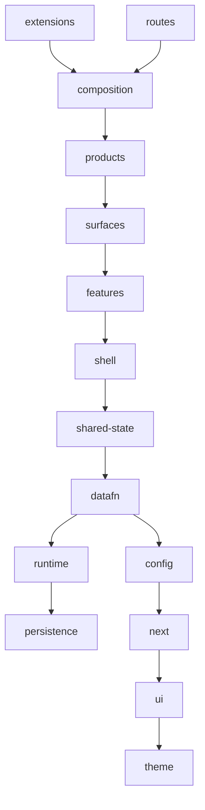
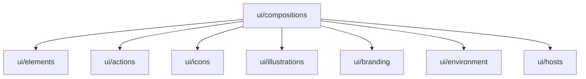
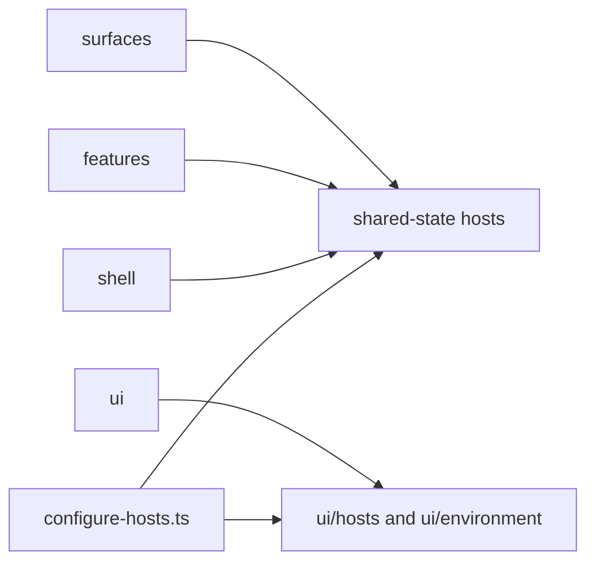
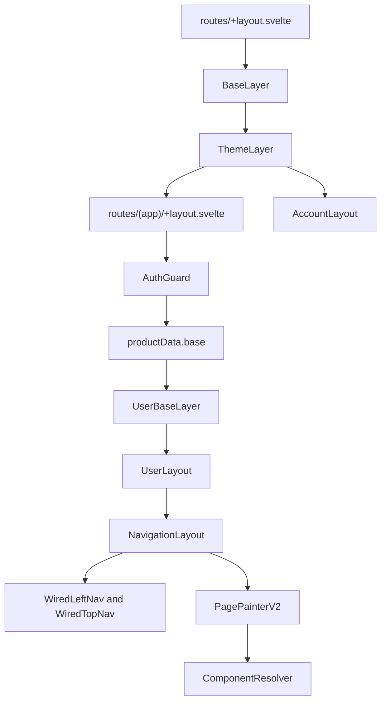
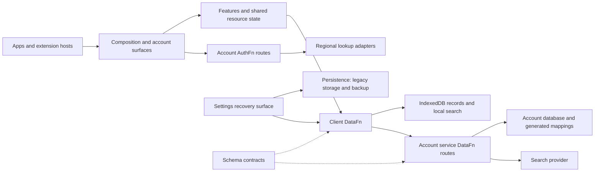

# Client dependency map

Readable view of the post-reorganization client graph and the Nucleum, Memotron, and Pointron component chain.

The enforced direct-import list is `tools/check/client-dependency-matrix.json`. `npm run check:architecture` rejects imports outside that matrix, including type-only imports. Ownership rules live in [client boundaries](client-boundaries.md). The phase journal lives in [TIDY-477 history](history/tidy-477-client-boundaries.md).

Arrows in the owner diagram mean "may import". An owner may also import its own files. The diagram is one valid top-to-bottom order, not every permitted edge. The matrix table below is the full permitted direct-import list between client owners, not an observed module graph or npm workspace graph.

For service, datastore, external-package and host boundaries, see [system architecture](system-architecture.md), [data and synchronization](data-and-sync.md), and [deployment topology](deployment-topology.md). Those runtime maps are separate from the client import policy below.

## Owner order

`apps/` entrypoints may assemble composition and products. Product source cannot import composition. `persistence`, `theme`, `static`, `ambient`, `app.css`, and `svelte.config.mjs` import no other client owner.

## Direct imports

| Importing owner | May import |
| --- | --- |
| `extensions` | `app.css`, `composition`, `config`, `datafn`, `features`, `persistence`, `runtime`, `shared-state`, `shell`, `surfaces`, `ui` |
| `routes` | `app.css`, `composition`, `config`, `datafn`, `persistence`, `products`, `runtime`, `shared-state`, `shell`, `surfaces`, `ui` |
| `composition` | `config`, `datafn`, `features`, `persistence`, `products`, `runtime`, `shared-state`, `shell`, `static`, `surfaces`, `ui` |
| `products` | `config`, `datafn`, `features`, `next`, `runtime`, `shared-state`, `shell`, `surfaces`, `ui` |
| `surfaces` | `config`, `datafn`, `features`, `next`, `persistence`, `runtime`, `shared-state`, `shell`, `theme`, `ui` |
| `features` | `config`, `datafn`, `persistence`, `runtime`, `shared-state`, `shell`, `theme`, `ui` |
| `shell` | `config`, `datafn`, `runtime`, `shared-state`, `theme`, `ui` |
| `shared-state` | `config`, `datafn`, `persistence`, `runtime`, `theme`, `ui` |
| `datafn` | `config`, `next`, `persistence`, `runtime` |
| `runtime` | `persistence` |
| `config` | `next` |
| `next` | `ui` |
| `ui` | `theme` |

Inside `client/ui`, compositions may use elements, actions, icons, illustrations, branding, environment, and hosts. Those lower layers cannot import compositions. The `ui` to `theme` edge in the owner diagram is the package boundary; it is not a claim that every UI sublayer imports theme.

Edges that stay closed:

- Features do not import products, surfaces, or composition. Shell is the only app-level layer they may use.
- Shell does not import composition, surfaces, or products.
- Surfaces do not import composition.
- Shared-state does not import composition, features, or products.
- DataFn and runtime do not import features, products, composition, shell, UI, or shared-state.
- UI does not import application state, runtime, shell, products, features, DataFn, persistence, schema, or domain state.

## Host inversion

Lower layers do not import composition to reach product behavior. `installApplicationHosts()` from `client/composition/configure-hosts.ts` is called by base, user, extension, and sheet layers. It installs narrow hosts before children render and reference-counts the platform subscription until the final root unmounts. Shell, features, surfaces, and UI call those hosts.

Product navigation reaches the shell only through `@nucleum/shared-state/product/product-config-host`. Brand, search, bulk edit, offline status, capture, and profile reach shell chrome as snippets from `client/composition/chrome/`. Persistence receives its logger through `persistence/logging-host`.

## App component chain

Nucleum, Memotron, and Pointron are thin SvelteKit hosts. Each app points its routes at `client/routes`. Product identity is `apps/<product>/src/local.ts`, which sets `base` to that product's layer.

| App | Assembly | Product layer |
| --- | --- | --- |
| Nucleum | `apps/nucleus/src/local.ts` | `NucleusBaseLayer` |
| Pointron | `apps/pointron/src/local.ts` | `PointronBaseLayer` |
| Memotron | `apps/memotron/src/local.ts` | `MemotronBaseLayer` |

Timear does not use this chain. Its routes live under `apps/timear/src/routes`.

`BaseLayer` boots the shared app: version, account session, launch context, command registry, service worker, then connectivity. Application hosts are installed explicitly before children render. The root route supplies product startup data to `BaseLayer`.

`AuthGuard` checks the product plan, sends an unbootstrapped cloud user to `/bootstrap`, and completes extension login. The app route then mounts `productData.base`.

`UserBaseLayer` initializes DataFn and legacy recovery. It renders `UserLayout` only after `isBaseLoaded` and `isLocalLoaded`. Until then it shows `AppLoadingView` or the recovery gate. `ModalLayer` and `ShortcutRunner` require only `isBaseLoaded`; Intercom mounts outside these loading gates.

`NavigationLayout` is the shell: left nav, top nav, split view, right panel, bottom nav, and trail. `PagePainterV2` maps the URL to an action. The action-renderer host is `ComponentResolver`, which renders that action's component. Panels, modals, and resource pages use the same resolver.

Account routes (`client/routes/account`) stop at `AccountLayout` from `client/surfaces/account`. They do not mount the product base layer.

## External owners and system flow

The client matrix does not enumerate third-party dependencies or schema/shared imports. Production `schema`, `shared`, `services`, and `server` sources cannot import client implementations. Client owners may consume schema contracts and shared helpers where their own contracts permit it; portable UI cannot reach schema or domain state, including through shared helpers. Tests are outside that production direction check.

This is a conceptual responsibility/data-flow diagram, not a deployment graph. Transport, database and lookup implementations are configured by the account service. Legacy recovery imports through the current DataFn runtime; legacy stores are not the active synchronization engine.

## Capability dependencies and remaining limits

The features owner contains calendar, collections, focus, memory, records, and spaces. Its public entrypoint list constrains cross-capability imports, but does not make the capability graph acyclic. Calendar consumes focus/memory; memory, focus, and collections have reciprocal contracts and rendering integrations; spaces composes multiple resource capabilities. Review changes to those edges as contract changes. Recursive Markdown and combination renderers are distinct from state-module cycles.

The owner graph is acyclic. The aggregate `@nucleum/client` manifest still groups runtime/config/next, so the npm dependency/peer graph is not equivalent. Splitting those workspaces is deferred until its build and distribution benefits justify the migration. Optional overlay aliases and framework-generated modules are build contracts, not ordinary workspace packages.
