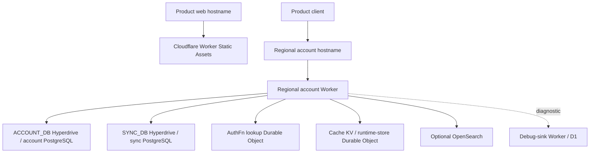

# Deployment topology

Source-reviewed on 2026-10-03. This is a map of checked-in deployment paths, not a live cloud inventory. Route attachment, secrets availability, migration state and deployed versions require separate operational verification. See [system architecture](system-architecture.md) and [data and synchronization](data-and-sync.md).

## Configured topology

The frontend serves a client bundle; it does not contain the account database adapters. Browser requests address the regional account service directly. Workers are logical deployment units; this diagram does not assert physical isolation or observed regional latency.

| Deployment unit | Configuration and execution sources |
| --- | --- |
| Product frontend | [frontend environments](../../services/frontend/config/environments.json), [scripts](../../services/frontend/scripts), and [Cloudflare workflow](../../.github/workflows/frontend-cloudflare-deploy.yml). Configured products are Nucleum, Memotron and Pointron. |
| Account service | [account environments](../../services/account/config/environments.json), [deploy script](../../services/account/scripts/deploy.mjs), [Wrangler generator](../../services/account/scripts/wrangler-config.mjs), and [account workflow](../../.github/workflows/account-service-deploy.yml). Regions are `insouth`, `useast`, `euwest`. |
| Lookup and runtime state | Account Worker wiring and generated bindings connect lookup and runtime-store Durable Objects, cache KV and the two Hyperdrive connections. See [worker.ts](../../services/account/src/worker.ts). |
| Debug sink | [services/debug-sink](../../services/debug-sink) owns a separate Worker, D1 migrations and diagnostic access controls. |
| AWS paths | [deployment/cdk](../../deployment/cdk) retains frontend, backend, files and database stacks. [turbo-deploy.yml](../../.github/workflows/turbo-deploy.yml) retains an AWS frontend deployment path. These sources coexist with Cloudflare configuration. |
| Native and extension bundles | App/native configuration and [extensions](../../extensions) define additional hosts. Their release/install state is not established by either web deployment workflow. |

The generic [deployment README](../../deployment/README.md) is not a complete runbook for these paths. Prefer the [account README](../../services/account/README.md), [frontend README](../../services/frontend/README.md), scripts and workflows for their specific units. References to previously deployed resources in runbooks are not fresh live verification.

## Environment and authority selection

Frontend configuration distinguishes `dev`, `pre`, and `live`, using `dev.`, `pre.`, and `web.` product hostnames. Account configuration additionally defines `local`. Account hostname convention is `account-<region>-<environment>.<product-domain>`, with the environment suffix omitted for live.

The client [authority resolver](../../client/runtime/account/network.ts) applies this precedence:

1. Native account configuration, when supplied.
2. `VITE_ACCOUNT_BASE_URL_TEMPLATE`, rendered for the selected region.
3. Explicit `VITE_ACCOUNT_BASE_URL`, a single authority regardless of selected region.
4. Product host/environment derivation; a loopback host has a separate localhost fallback.

A fixed URL override can intentionally collapse regional routing. Product, web origin and account authority must agree across native configuration and the built web bundle. Client `VITE_*` values are build inputs, not server secrets.

The account environment config currently contains placeholder Hyperdrive identifiers for pre and live. The deployment script validates required identifiers and refuses deployment when unresolved. An environment label therefore does not establish deployability, isolated data or available credentials; inspect resolved bindings and migration targets before a release. Do not copy credentials or opaque infrastructure identifiers into architecture docs.

## Local runtime

[Caddyfile](../../Caddyfile) defines the local HTTPS entrypoints:

| Host or route | Upstream |
| --- | --- |
| `local.nucleum.app` | `localhost:5050` |
| `local.pointron.app` | `localhost:5001` |
| `local.memotron.app` | `localhost:5002` |
| Local account `insouth` | `localhost:8787` |
| Local account `useast` | `localhost:8788` |
| Local account `euwest` | `localhost:8789` |
| Local insouth account `/debug-sink/*` | `localhost:8790` |

The account package supports Node development and local multi-region Worker development; these are different adapter choices. Node uses PostgreSQL connection variables and memory runtime stores. Worker mode uses its configured bindings and can depend on remote development resources. The word `local` does not by itself guarantee all persistence is local.

A debug-sink response says nothing about the normal account upstream. Check `/auth/session` and a DataFn preflight through the expected Caddy hostname before attributing login or sync failures to the frontend. The [constitution](../../AGENTS.md) provides the diagnostic order and commands.

## Release boundaries

The account workflow selects dev from the dev branch and pre/live from `backend-pre-*` / `backend-live-*` tags, with manual dispatch constraints. The frontend workflow independently selects `frontend-pre-*` / `frontend-live-*` tags and product targets. Frontend and backend revisions can therefore differ.

The account deploy script validates configuration, applies committed DataFn migrations to each selected regional database, builds, then deploys lookup and regional Workers. A dry run skips database migrations. This ordering is not an atomic release across regions: partial migration or deployment failure needs explicit inspection before retry or rollback.

Route and WAF reconciliation are separate scripts from code deployment; the frontend also has a [route workflow](../../.github/workflows/frontend-cloudflare-routes.yml). A successful bundle build or Worker upload does not prove DNS, route attachment, origin policy, secrets, database connectivity or user-visible behavior.

## Verification scope

For documentation and configuration review, validate source links, workspace selectors and the frontend config check. For a release, collect separate evidence for selected revisions, generated configuration, migration completion, routes/bindings and application smoke tests. Include authentication, durable record synchronization, search, and any affected native/extension flow.

No deployment, migration, route change or live infrastructure audit was performed to produce these documents. A future live inventory should reconcile Cloudflare and AWS ownership and identify which retained paths still serve traffic before any retirement decision.
