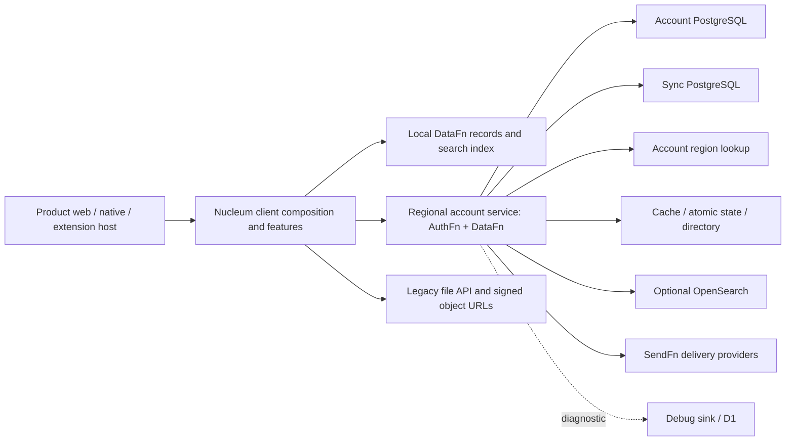

# System architecture

This is the repository-wide boundary map, source-reviewed on 2026-10-03. It describes checked-in integration and configuration, not verified live infrastructure. The [client dependency map](client-dependency-map.md) remains the enforced client import policy; it is not a system deployment graph.

Read [data and synchronization](data-and-sync.md) for persistence and request flows, and [deployment topology](deployment-topology.md) for runtime placement and environment selection.

## System context

Arrows below mean runtime communication or data access, not permission to import a package.

## Ownership

| Boundary | Repository owner and responsibility |
| --- | --- |
| Product bundle | [apps](../../apps) supplies build and app-local configuration; [products](../../client/products) supplies product behavior and feature configuration. Routes and [composition](../../client/composition) assemble the running client. |
| Client capability | [features](../../client/features) owns domain workflows, [surfaces](../../client/surfaces) composes capabilities, [shell](../../client/shell) owns navigation and layout. See [client boundaries](client-boundaries.md) for the complete policy. |
| Client persistence and transport | [DataFn](../../client/datafn) owns runtime initialization, local record storage and sync integration; [persistence](../../client/persistence) owns key-value and legacy recovery mechanisms; [runtime](../../client/runtime) owns platform and network mechanics. |
| Shared domain contract | [schema](../../schema) owns resource definitions and search configuration used by client and service; [shared](../../shared) holds cross-layer utilities. Neither is a client feature implementation. |
| Account application | [services/account/src/app.ts](../../services/account/src/app.ts) composes auth, sync, delivery, middleware and observability. [node.ts](../../services/account/src/node.ts) and [worker.ts](../../services/account/src/worker.ts) supply platform adapters. |
| Identity and regional routing | [auth.ts](../../services/account/src/auth.ts), [auth plugins](../../services/account/src/auth/plugins.ts), and [lookup](../../services/account/src/lookup) own Nucleum integration and policy. |
| Record API and authorization | [DataFn server](../../services/account/src/datafn/server.ts) binds schema, actor namespace, session/mutation authorization, public links, search and rate limits. |
| Database mapping and evolution | [generated mappings](../../services/account/src/db/generated), [DataFn schema entry](../../services/account/src/datafn/sync.datafn.ts), and [migrations](../../services/account/drizzle/datafn) connect domain schema to physical storage. Generated files are outputs, not an independent domain authority. |
| Hosting | [frontend service](../../services/frontend), [account scripts](../../services/account/scripts), [debug sink](../../services/debug-sink), and [deployment](../../deployment) contain separate deployment responsibilities. |

## External Superfunctions boundary

These are package dependencies, not source owners in the client matrix. The [account manifest](../../services/account/package.json), [client manifest](../../client/package.json), [DataFn manifest](../../client/datafn/package.json), and lockfile define the installation contract. Local linked installations may differ from published artifacts; package implementation guarantees require review of the actual resolved version.

| Package family | Responsibility delegated by repository integration | Repository-owned decisions |
| --- | --- | --- |
| AuthFn and plugins | Session/auth mechanisms, regional client, lookup adapters and native handoff | Enabled plugins, product authorities, allowed origins, account lifecycle and bootstrap |
| DataFn client/core/server | Record client and server protocol, storage interfaces and synchronization machinery | Resource schema, namespace, mode, hydration sets, auth callbacks and storage lifecycle |
| SearchFn adapters/provider | Search indexing and provider implementation | Searchable fields, pipeline, local IndexedDB vs server OpenSearch selection |
| Superfunctions DB/HTTP/middleware/observability | Database/runtime-store interfaces and shared infrastructure | Concrete adapter wiring, limits, regional placement and diagnostic integration |
| SendFn | Delivery integration | Account delivery configuration and local testing behavior |
| ApiFn and schema-generation CLIs | Development/test and generation tooling | Test inputs, generation entrypoints and committed migrations |

Changes to external protocol or adapter behavior belong in their source packages; changes to Nucleum configuration and policy belong here. This map does not claim that the repository's import checker validates external package internals.

## Host and extension transports

| Host boundary | Transport and evidence |
| --- | --- |
| Browser extension contexts | [runtime/extensions/messaging.ts](../../client/runtime/extensions/messaging.ts) uses Chrome tab/runtime messaging and Plasmo background messaging. [client/extensions](../../client/extensions) contains connected extension UI and clipper sources. Presence of those sources does not establish a deployable clipper app workspace. |
| Native or embedded webview | [embed.utils.ts](../../client/runtime/embed/embed.utils.ts) sends parent-window, WebKit and WebView messages. [native-message.ts](../../client/runtime/embed/native-message.ts) provides a source/origin-aware decoder. Consumers must be checked individually; this is not a claim that every receiver uses that decoder. |
| Memotron share host | [extensions/memotron-share](../../extensions/memotron-share) hosts a Svelte share route with its own native message receiver and shared client integration. |
| Timear browser extension | [extensions/timear](../../extensions/timear) has content/background timer messaging; it is a distinct host from the main product apps. |

These message channels cross host boundaries. They are not DataFn replication channels and do not replace account-service authorization.

## Enforcement and remaining coverage

The client checker enforces source import policy, not deployment reachability, database privileges, network origin policy or the complete npm graph. Account authorization, adapter configuration, schema migrations and host message validation require their own checks.

The repository still contains legacy APIs and AWS infrastructure beside the account-service path. File upload is a concrete surviving path: [file-transport.ts](../../client/runtime/files/file-transport.ts) requests signed URLs through the legacy API, then uploads directly. Do not infer that all backend traffic has moved to `/datafn/*`.

The next useful governance step is to keep these system maps current when a service, datastore, transport or deployment selector changes. A live inventory of routes, bindings, database migration state and deployed versions remains separate operational evidence.
